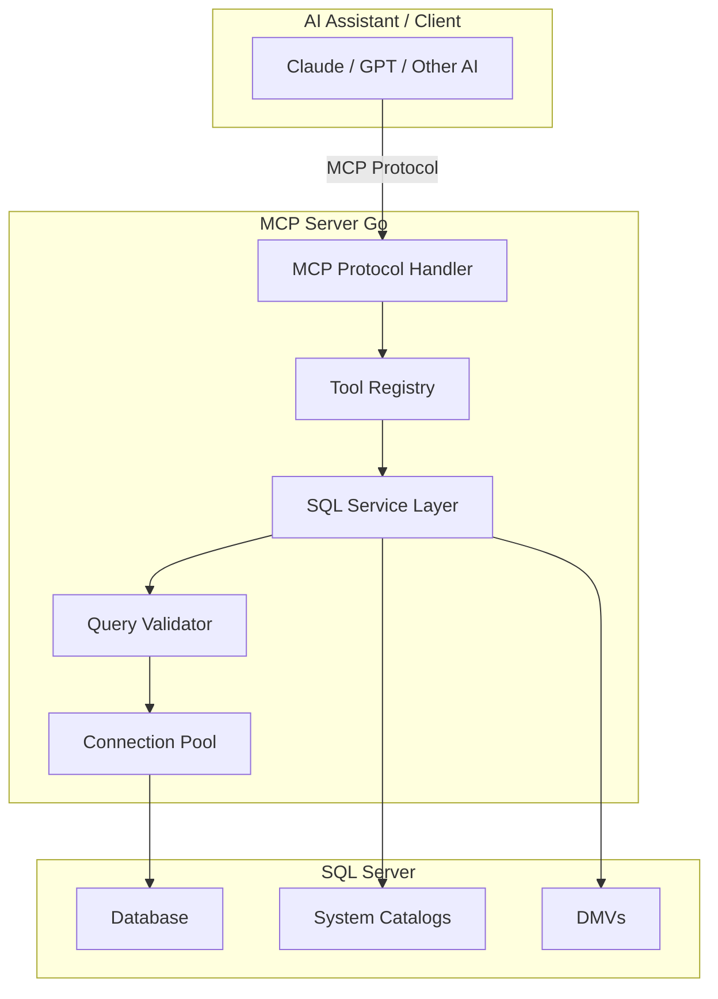

# 🗄️ MSSQL MCP Server (Go)

[](https://golang.org)
[](https://modelcontextprotocol.io)
[](LICENSE)

A powerful **Model Context Protocol (MCP)** server implementation in Go that provides comprehensive **read-only** access to Microsoft SQL Server databases. Perfect for AI assistants, database analysis, migration planning, and schema exploration.

## 🌟 Features

### 📊 Database Discovery & Analysis
- **Schema Exploration**: List tables, views, functions, stored procedures, and triggers
- **Relationship Mapping**: Visualize foreign key relationships and dependencies
- **Object Dependencies**: Track which objects reference or are referenced by others
- **Complexity Analysis**: Assess database structure complexity for migration planning

### 🔍 Advanced Querying
- **Safe Read-Only Queries**: Execute SELECT statements with built-in safety checks
- **Query Performance Analysis**: Get execution plans and cost estimates
- **Data Profiling**: Analyze column statistics, distributions, and null values
- **Sample Data Extraction**: Preview table contents with configurable limits

### 🔐 Security & Performance
- **Read-Only Mode**: All operations are strictly read-only (no INSERT/UPDATE/DELETE)
- **Connection Pooling**: Efficient connection management with configurable pool settings
- **Query Validation**: Automatic detection and blocking of dangerous SQL operations
- **Performance Monitoring**: Track query performance and index usage

### 🚀 Migration Support
- **Migration Assessment**: Comprehensive analysis for database migration planning
- **Dependency Graphs**: Visualize object dependencies for migration ordering
- **Complexity Scoring**: Automated complexity assessment for migration effort estimation
- **Risk Detection**: Identify high-risk objects (dynamic SQL, cursors, etc.)

## 📐 Architecture



## 🛠️ Available Tools

### Discovery Tools
| Tool | Description | Use Case |
|------|-------------|----------|
| `list_tables` | List all tables with row counts | Schema exploration |
| `list_views` | List all views | Understanding data abstractions |
| `list_procedures` | List stored procedures | Business logic discovery |
| `list_functions` | List user-defined functions | Reusable logic identification |
| `describe_table` | Get detailed table structure | Schema documentation |

### Analysis Tools
| Tool | Description | Use Case |
|------|-------------|----------|
| `analyze_database_for_migration` | Comprehensive migration assessment | Migration planning |
| `analyze_execution_plan` | Get query execution plan | Performance optimization |
| `database_complexity_report` | Structural complexity metrics | Architecture assessment |
| `find_missing_indexes` | Identify missing indexes | Performance tuning |
| `find_unused_indexes` | Find unused indexes | Optimization |

### Query Tools
| Tool | Description | Use Case |
|------|-------------|----------|
| `execute_query` | Run read-only SELECT queries | Data exploration |
| `sample_table_data` | Get sample rows from table | Quick data preview |
| `column_statistics` | Compute column statistics | Data profiling |
| `data_distribution` | Analyze value distributions | Data quality analysis |

### Relationship Tools
| Tool | Description | Use Case |
|------|-------------|----------|
| `foreign_key_graph` | Get FK relationship graph | Schema visualization |
| `dependency_graph` | Build object dependency tree | Impact analysis |
| `table_relationships` | Show table connections | Data modeling |
| `find_circular_dependencies` | Detect FK cycles | Schema validation |

[View complete tool list →](docs/TOOLS.md)

## 🚀 Quick Start

### Prerequisites
- Go 1.21 or higher
- Access to a Microsoft SQL Server database
- MCP-compatible client (Claude Desktop, Cline, etc.)

### Installation

1. **Clone the repository**
```bash
git clone https://github.com/yourusername/mssql-mcp-go.git
cd mssql-mcp-go
```

2. **Configure database connection**
```bash
cp config.yaml.example config.yaml
# Edit config.yaml with your database credentials
```

3. **Build the server**
```bash
go build -o mcp-server ./cmd/server
```

4. **Run the server**
```bash
./mcp-server
```

### Configuration

Create a `config.yaml` file:

```yaml
database:
  server: "localhost"
  port: 1433
  database: "YourDatabase"
  user: "your_username"
  password: "your_password"
  
  # Connection pool settings
  max_open_conns: 25
  max_idle_conns: 5
  conn_max_lifetime: 5m
  
  # Security
  encrypt: true
  trust_server_certificate: false

logging:
  level: "info"
  format: "json"
```

### MCP Client Configuration

#### Claude Desktop
Add to your `claude_desktop_config.json`:

```json
{
  "mcpServers": {
    "mssql-readonly": {
      "command": "/path/to/mcp-server",
      "args": [],
      "env": {
        "CONFIG_PATH": "/path/to/config.yaml"
      }
    }
  }
}
```

#### Cline (VS Code)
Add to your Cline MCP settings:

```json
{
  "mssql-readonly": {
    "command": "/path/to/mcp-server",
    "args": [],
    "env": {
      "CONFIG_PATH": "/path/to/config.yaml"
      }
  }
}
```

## 💡 Usage Examples

### Example 1: Database Schema Exploration

```
User: "Show me all tables in the database"
AI uses: list_tables

User: "Describe the structure of the Users table"
AI uses: describe_table with table="Users"

User: "What are the foreign key relationships for Orders table?"
AI uses: table_relationships with table="Orders"
```

### Example 2: Migration Planning

```
User: "I need to migrate this database to PostgreSQL. Give me an assessment."
AI uses: analyze_database_for_migration

Result:
- Object inventory (tables, views, procedures, functions)
- Large tables requiring special handling
- High-risk objects (dynamic SQL, cursors)
- Recommended migration order
- Complexity score and effort estimation
```

### Example 3: Performance Analysis

```
User: "Why is this query slow: SELECT * FROM Orders WHERE CustomerID = 123"
AI uses: analyze_execution_plan with query="SELECT * FROM Orders WHERE CustomerID = 123"

AI uses: find_missing_indexes

Result:
- Execution plan analysis
- Missing index recommendations
- Performance optimization suggestions
```

### Example 4: Data Quality Analysis

```
User: "Analyze the data quality of the Email column in Users table"
AI uses: column_statistics with table="Users", column="Email"
AI uses: column_null_analysis with table="Users", column="Email"
AI uses: column_distinct_values with table="Users", column="Email"

Result:
- Null percentage
- Distinct value count
- Most common values
- Data distribution insights
```

## 🔒 Security Features

### Read-Only Enforcement
- All queries are validated before execution
- Dangerous operations (INSERT, UPDATE, DELETE, DROP, etc.) are blocked
- Stored procedures and functions are analyzed, not executed
- No schema modifications allowed

### Query Validation
```go
// Blocked operations
- INSERT, UPDATE, DELETE
- DROP, ALTER, CREATE
- TRUNCATE, EXEC
- sp_executesql
- xp_cmdshell
- OPENQUERY, OPENROWSET
```

### Connection Security
- Encrypted connections supported
- Certificate validation
- Connection pooling with limits
- Automatic connection cleanup

## 🏗️ Project Structure

```
mssql-mcp-go/
├── cmd/
│   └── server/
│       └── main.go              # Server entry point
├── internal/
│   ├── adapters/
│   │   └── mcp/                 # MCP protocol implementation
│   │       ├── server.go
│   │       ├── tools_*.go       # Tool implementations
│   │       └── handlers.go
│   ├── mssql/                   # SQL Server service layer
│   │   ├── service.go
│   │   ├── discovery.go
│   │   ├── analysis.go
│   │   ├── relationships.go
│   │   └── migration.go
│   └── config/
│       └── config.go            # Configuration management
├── config.yaml.example          # Example configuration
├── go.mod
└── README.md
```

## 🤝 Contributing

Contributions are welcome! Please feel free to submit a Pull Request.

### Development Setup

1. Fork the repository
2. Create your feature branch (`git checkout -b feature/AmazingFeature`)
3. Commit your changes (`git commit -m 'Add some AmazingFeature'`)
4. Push to the branch (`git push origin feature/AmazingFeature`)
5. Open a Pull Request

### Adding New Tools

1. Define the tool in `internal/adapters/mcp/tools_*.go`
2. Implement the business logic in `internal/mssql/*.go`
3. Add tests
4. Update documentation

## 📝 License

This project is licensed under the MIT License - see the [LICENSE](LICENSE) file for details.

## 🙏 Acknowledgments

- [Model Context Protocol](https://modelcontextprotocol.io) by Anthropic
- [go-mssqldb](https://github.com/denisenkom/go-mssqldb) - SQL Server driver for Go
- The Go community for excellent tooling and libraries

## 📞 Support

- 📧 Email: vinaykumaree5@gmail.com
- 🐛 Issues: [GitHub Issues](https://github.com/yourusername/mssql-mcp-go/issues)
- 💬 Discussions: [GitHub Discussions](https://github.com/yourusername/mssql-mcp-go/discussions)

## 🗺️ Roadmap

- [ ] Support for Azure SQL Database
- [ ] Query result caching
- [ ] Export to various formats (CSV, JSON, Excel)
- [ ] Schema comparison tools
- [ ] Data masking for sensitive columns
- [ ] Integration with popular BI tools
- [ ] GraphQL-style query interface
- [ ] Real-time change notifications

---

<div align="center">

**Made with ❤️ for the database community**

[⭐ Star us on GitHub](https://github.com/yourusername/mssql-mcp-go) | [📖 Documentation](docs/) | [🐛 Report Bug](https://github.com/yourusername/mssql-mcp-go/issues)

</div>